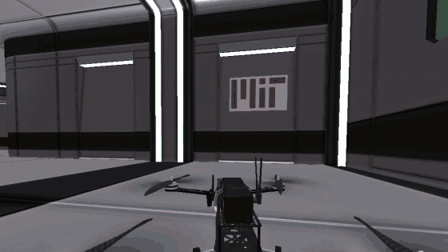
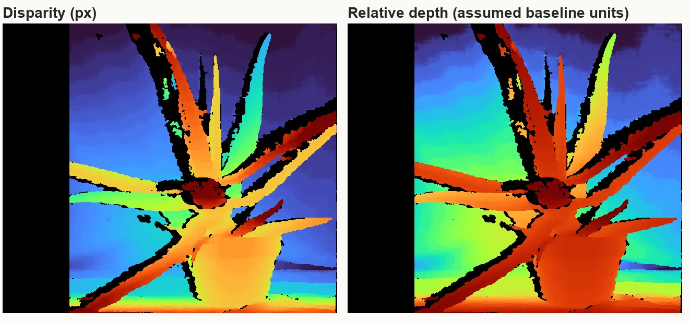
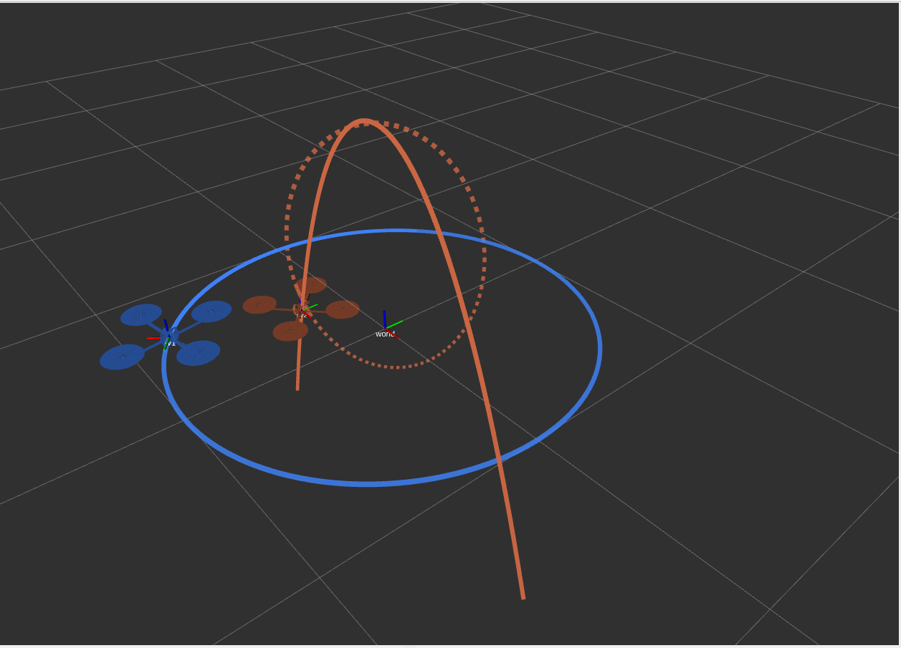
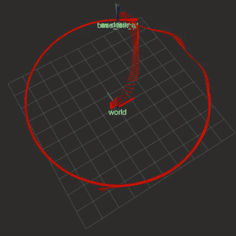
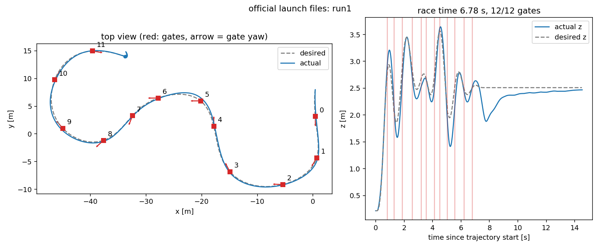

<div align="center">

**English** · [简体中文](./README.zh-CN.md)

# Robotics Integration I · VNAV Labs

Fall 2026 coursework: camera calibration, ROS, quadrotor control and drone racing (LAB1 onward follows MIT VNAV)

[Results](#results) · [Demo](#demo) · [Quick start](#quick-start) · [Environment](#environment)

[![Ubuntu 20.04 · WSL2][ubuntu-shield]][ubuntu-link]
[![ROS Noetic][ros-shield]][ros-link]
[![Unity 2019.3][unity-shield]][unity-link]
[![macOS 26][macos-shield]][macos-link]
<br>
[![C++11][cpp-shield]][cpp-link]
[![Python 3.8 | 3.9][python-shield]][python-link]
[![OpenCV 4][opencv-shield]][opencv-link]
[![LaTeX · Tufte][latex-shield]][latex-link]



<sub>LAB4 race: 12/12 gates in 6.78 s (official-launch rerun, simulator view) · best run 6.74 s</sub>

</div>

## Results

| Lab | Content | Key result | Reproduce / report / evidence |
| :-- | :-- | :-- | :-- |
| ✅&nbsp;[LAB0](lab0/readme.md) | Zhang camera calibration · stereo rectification and depth · two paper translations | [0.942 px](lab0/results/calibration/summary.json) reprojection RMS on a phone camera (19 images, 4032×3024) | [Reproduce](lab0/HUMANS.md) · [Calibration](lab0/reports/lab0_1_camera_calibration.pdf) · [Stereo](lab0/reports/lab0_2_stereo_depth.pdf) · [Translations](lab0/translation/) |
| ✅&nbsp;[LAB1](lab1/README.md) | Ubuntu setup · shell · C++ questions and practice | — | [Reproduce](lab1/HUMANS.md) · [Report](lab1/report/lab1-report.pdf) · [Screenshots](lab1/results/figures/) |
| ✅&nbsp;[LAB2](lab2/README.md) | ROS install · TF-driven two-drone motion · quaternion derivations | — | [Reproduce](lab2/HUMANS.md) · [Report](lab2/report/lab2_report.pdf) · [Screenshots](lab2/results/screenshots/) |
| 🚧&nbsp;[LAB3](lab3/README.md) | Quadrotor geometric controller · circle tracking · gain tuning | [4.3 cm](lab3/results/logs/final_circle_summary.txt) position RMS, 0.26° pitch jitter | [Reproduce](lab3/HUMANS.md) · [Results](lab3/results/) |
| 🚧&nbsp;[LAB4](lab4/README.md) | Minimum-snap trajectory generation · 12-gate race | 12/12 gates, best [6.74 s](lab4/results/logs/fastest_run_summary.txt), official reruns [6.78](lab4/results/logs/official_run1_summary.txt) / [6.80 s](lab4/results/logs/official_run2_summary.txt) | [Reproduce](lab4/HUMANS.md) · [Results](lab4/results/) |
| ⏳&nbsp;LAB5 | Feature extraction, matching and tracking (SIFT · FLANN · LK) | | |
| ⏳&nbsp;LAB6 | Two-view pose estimation (5-point · 2D-2D · 3D-3D) | | |
| ⏳&nbsp;LAB9 | VIO / SLAM runs and trajectory evaluation (Kimera · ORB-SLAM3) | | |

<sub>✅ done · 🚧 experiments done, report in progress · ⏳ not started</sub>

<sub>LAB4 pass criterion: the drone centre enters each gate's 0.6 m ball in order; the simulator's gates are sprites without colliders. Timing runs from trajectory start to the first entry into the last gate's 0.6 m ball, see [environment.txt](lab4/results/logs/environment.txt).</sub>

## Demo

<table>
  <tr>
    <th>LAB0 · Stereo depth</th>
    <th>LAB2 · TF and trajectories</th>
  </tr>
  <tr>
    <td></td>
    <td></td>
  </tr>
  <tr>
    <td align="center"><sub>SGBM disparity (left) and relative depth (right), OpenCV aloe pair</sub></td>
    <td align="center"><sub>Blue: AV1 in world; red solid / dashed: AV2 in world / av1</sub></td>
  </tr>
  <tr>
    <th>LAB3 · Geometric controller on a circle</th>
    <th>LAB4 · Race trajectory</th>
  </tr>
  <tr>
    <td></td>
    <td></td>
  </tr>
  <tr>
    <td align="center"><sub>RViz: the drone flying the circle; red is the odometry trail</sub></td>
    <td align="center"><sub>Official rerun: top view with the 12 gates (left), altitude tracking (right)</sub></td>
  </tr>
</table>

## Quick start

**LAB0 stereo depth**: pure Python with the data in the repository, so it runs right after cloning (tested with Python 3.9).

```bash
python3.9 -m venv lab0/.venv && source lab0/.venv/bin/activate
python -m pip install -r lab0/requirements.txt
python lab0/code/stereo_depth.py --scale 0.5   # writes lab0/results/stereo/
```

**LAB4 race**: one-time setup and the environment to source in each terminal are in [lab4/HUMANS.md](lab4/HUMANS.md); start everything from an Ubuntu terminal on the Windows desktop so the simulator window shows.

```bash
# Terminal 1: Unity simulator (WSLg needs -force-gfx-direct -force-glcore33)
cd ~/vnav-builds/lab4 && env -u LIBGL_ALWAYS_SOFTWARE ./lab4.x86_64 -force-gfx-direct -force-glcore33 \
  -screen-fullscreen 0 -screen-width 1024 -screen-height 768
# Terminal 2
roscore
# Terminal 3: simulator ↔ ROS bridge
roslaunch tesse_ros_bridge tesse_quadrotor_bridge.launch publish_collisions:=true
# Terminal 4: trajectory generation + controller (LAB3 gains)
roslaunch trajectory_generation traj_following.launch
# Terminal 5: publish the gate poses; the race starts and takes about 7 s
roslaunch planner_pkg traj_gen.launch
```

Reset, pass criterion, the one-shot script and the speed-up history are in [lab4/HUMANS.md](lab4/HUMANS.md). Every lab folder has a `HUMANS.md` (in Chinese) with copy-paste commands for each grading item; the reasoning is in `PLAN.md` and the reports.

## Environment

| Machine | Role | Software |
| :-- | :-- | :-- |
| MacBook · macOS 26 | Main machine: editing, LAB0, LaTeX reports | Python 3.9.23 · NumPy 2.0.2 · OpenCV 4.12.0 |
| Windows 11 host · WSL2 | Ubuntu / ROS environment and Unity simulators for LAB1–4 | Ubuntu 20.04.6 · ROS Noetic · Python 3.8.10 · catkin (C++11) · RTX 4070 SUPER |

The Mac drives WSL over SSH; Moonlight streams the Windows desktop when the simulator window is needed.

> [!NOTE]
> The VNAV Unity simulators need three fixes under WSLg: `-force-gfx-direct -force-glcore33` for LAB4 (single-threaded rendering, and no OpenGL version probing, which crashes the player at start-up), `python3` shebangs in the bridge nodes, and a patch for the bridge's assertion when the simulator clock resets. Details: [LAB3 environment.txt](lab3/results/logs/environment.txt) and [LAB4 environment.txt](lab4/results/logs/environment.txt).

## Repository layout

```text
.
├── lab0/ … lab4/    HUMANS.md (commands) · PLAN.md (reasoning) · code · results/ · report
├── report-style/    shared Tufte LaTeX preamble for the reports
├── assets/          README media
├── HUMANS.md        repository index (Chinese)
├── AGENTS.md        project conventions
├── syllabus.md      course description and grading (Chinese)
└── calendar.md      teaching calendar (Chinese)
```

## Acknowledgements

- Lab handouts, code skeletons and Unity simulators come from MIT [VNAV](https://vnav.mit.edu/) ([MIT-SPARK/VNAV-labs](https://github.com/MIT-SPARK/VNAV-labs), tag `VNAV2023`).
- Papers translated in LAB0: Z. Zhang, *Flexible Camera Calibration by Viewing a Plane from Unknown Orientations*, ICCV 1999; A. Fusiello, E. Trucco, A. Verri, *A Compact Algorithm for Rectification of Stereo Pairs*, Machine Vision and Applications, 2000.

<sub>Coursework archive for learning purposes; please follow your course's academic-integrity policy.</sub>

<!-- badge definitions: keep identical in README.md and README.zh-CN.md -->
[ubuntu-shield]: https://img.shields.io/badge/Ubuntu-20.04%20%C2%B7%20WSL2-E95420?logo=ubuntu&logoColor=white
[ubuntu-link]: https://releases.ubuntu.com/focal/
[ros-shield]: https://img.shields.io/badge/ROS-Noetic-22314E?logo=ros&logoColor=white
[ros-link]: https://wiki.ros.org/noetic
[unity-shield]: https://img.shields.io/badge/Simulator-Unity%202019.3-000000?logo=unity&logoColor=white
[unity-link]: https://vnav.mit.edu/
[macos-shield]: https://img.shields.io/badge/macOS-26-000000?logo=apple&logoColor=white
[macos-link]: https://www.apple.com/macos/
[cpp-shield]: https://img.shields.io/badge/C%2B%2B-11-00599C?logo=cplusplus&logoColor=white
[cpp-link]: https://en.cppreference.com/w/cpp/11
[python-shield]: https://img.shields.io/badge/Python-3.8%20%7C%203.9-3776AB?logo=python&logoColor=white
[python-link]: https://www.python.org/
[opencv-shield]: https://img.shields.io/badge/OpenCV-4.x-5C3EE8?logo=opencv&logoColor=white
[opencv-link]: https://github.com/opencv/opencv
[latex-shield]: https://img.shields.io/badge/Report-LaTeX%20%C2%B7%20Tufte-008080?logo=latex&logoColor=white
[latex-link]: https://github.com/Tufte-LaTeX/tufte-latex
